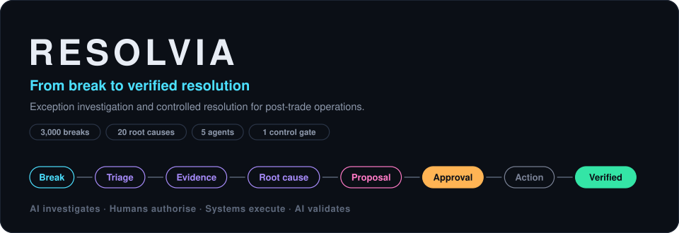
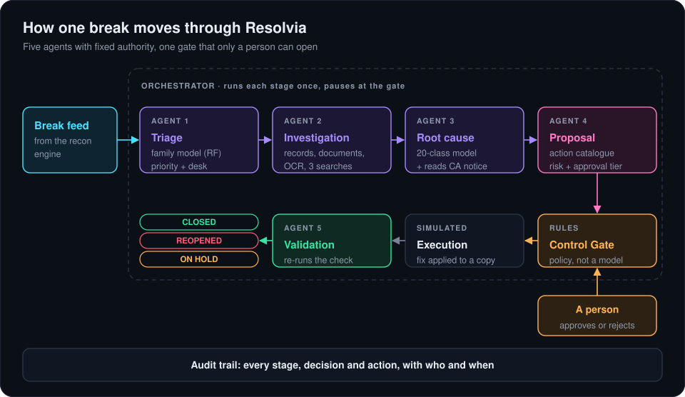
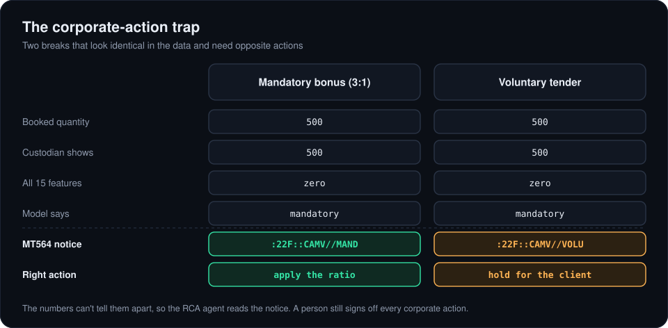
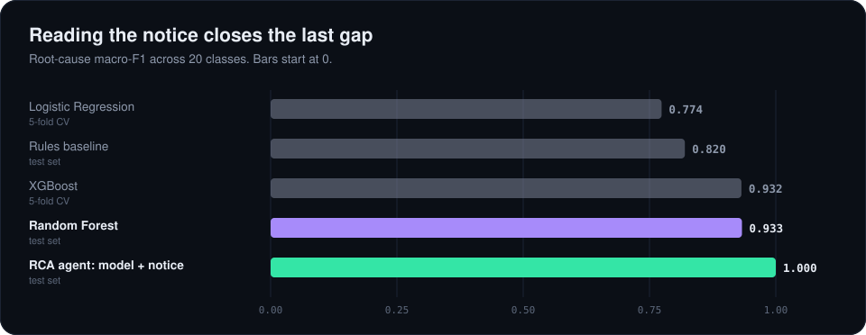
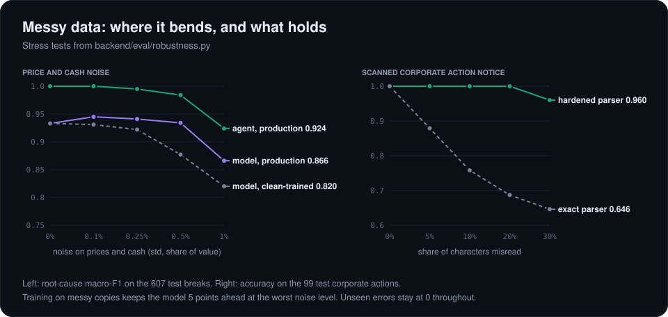
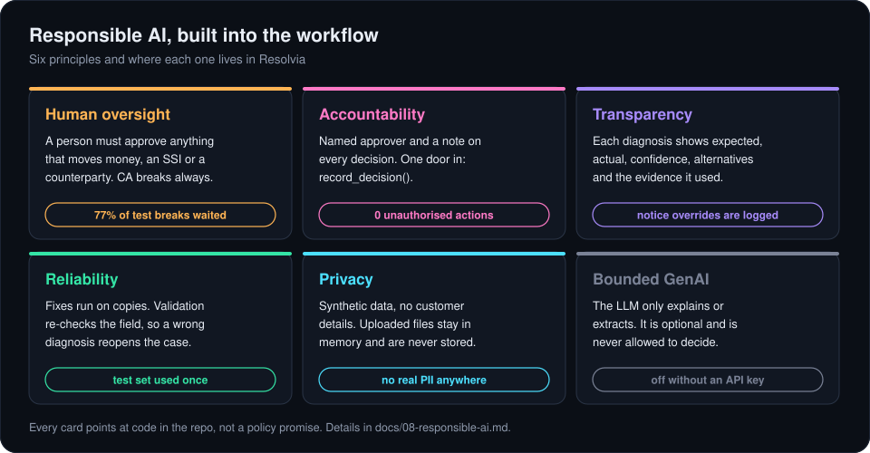

<p align="center">
  
</p>

<p align="center">
  <a href="https://resolvia.streamlit.app/"></a>
</p>

<p align="center">
  
  
  
  
  
  
  
</p>

When two systems in a bank disagree about a trade, a reconciliation engine raises a break. Finding that break is a solved problem. Fixing it is not: it still means someone digging through trade records, settlement messages, custodian statements and emails, working out what went wrong, getting sign-off and then checking the fix actually worked.

I built Resolvia to do that legwork for cash-equity breaks. Six agents, wired together as a LangGraph state graph, gather the evidence, diagnose the root cause, dig further when a case looks unusual, propose a fix and check the result, and a hard-coded gate makes sure nothing that moves money happens without a named person approving it.

The principle I designed it around:

> **AI investigates. Humans authorise. Systems execute. AI validates.**

## How a break moves through it



1. **Triage** checks the records exist, predicts the break family, sets a priority and routes it to the right desk.
2. **Investigation** pulls the trade, position, cash and settlement records, reads the document (with OCR if it's a scan) and finds similar documents and corporate-action rules.
3. **Root cause** runs a 20-class model, reads the corporate action notice where there is one, and decides whether a person needs to review the diagnosis.
   - **Investigator** takes over when a case looks unusual (low confidence, a notice that contradicts the model, a family the engine tagged differently). It's an LLM with read-only tools that decides for itself what to check next, loops until it has a finding, and passes that finding to the reviewer.
4. **Proposal** looks up the fix, sizes the exposure and sets whether the action needs approval.
5. **The Control Gate** blocks anything consequential until a person approves it.
6. **Validation** re-runs the check that raised the break. Closed means the field now matches; anything else reopens.

Each step is a node in a [LangGraph](https://github.com/langchain-ai/langgraph) graph. Conditional edges route each case by what the agents found, and the approval step is a LangGraph interrupt: the graph pauses at the gate and resumes from that exact point once a person decides.

## The finding the project rests on



A mandatory corporate action that wasn't applied and a voluntary one waiting for the client's decision look identical in the data. The model can't tell them apart (it gets 18 of 20 root causes perfect and fails exactly here), a rules engine can't either, and the right actions are opposite. The difference is one field on the SWIFT notice. So I made the RCA agent read the notice, and I still send every corporate action to a person.



| | |
|---|---:|
| Trades / breaks | 6,000 / 3,000 |
| Root causes / families | 20 / 4 |
| Rules baseline, root-cause macro-F1 | 0.820 |
| Random Forest, root-cause macro-F1 | 0.933 |
| RCA agent with the notice, root-cause macro-F1 | 1.000 |
| RCA agent under the messiest stress test | 0.973 |
| Wrong fixes that ran unnoticed, in every stress test | 0 |
| Test breaks that needed a person before anything ran | 77% |
| Unauthorised executions | 0 |
| OCR accuracy on scanned confirms | ~99% |

All of this is on synthetic data. I explain what that does and doesn't prove in [the results](docs/06-results.md).

## How it holds up when the data gets messy



Clean data flatters any model, so I added noise to prices and cash, gave some trades a second fault, and damaged or removed the corporate action notices. Accuracy bends; safety doesn't. In every scenario, wrong diagnoses either reached a person or failed the re-check and reopened. Along the way I trained the production model on messy copies of the data, calibrated its confidence, chose the review threshold by cost, measured how much human review is really needed, and built a scored test for the LLM's document reading. The details are in [stress tests and modelling depth](docs/09-robustness.md).

## Responsible AI



In operations a wrong automated action means a failed payment, so I built governance into the workflow rather than writing it up afterwards. I explain how each principle maps to the code, and to the NIST AI Risk Management Framework, in [Responsible AI and governance](docs/08-responsible-ai.md). The root-cause model has its own [model card](docs/model-card.md).

## Take the tour

I've written the whole project up in [`docs`](docs), one picture at a time:

1. [The problem](docs/01-the-problem.md): why matching is solved and resolution isn't
2. [The data](docs/02-the-data.md): a synthetic bank where every fault is known
3. [The models](docs/03-the-models.md): features, the target choice, and how 0.933 is made
4. [The agents](docs/04-the-agents.md): six specialists and what each may do
5. [Control and audit](docs/05-control-and-audit.md): the gate, case states and the trail
6. [Results](docs/06-results.md): rules vs model vs the whole system
7. [Limits and next steps](docs/07-limits-and-next-steps.md): what production would need
8. [Responsible AI and governance](docs/08-responsible-ai.md): oversight, accountability and the model card
9. [Stress tests and modelling depth](docs/09-robustness.md): messy data, calibration, review policy and the LLM test

The [field guide](docs/field-guide.pdf) tells the same story on phone-sized pages.

## Run it

Use the [live app](https://resolvia.streamlit.app/), or run it locally with Python 3.10 or newer:

```bash
python -m venv .venv
.venv\Scripts\activate            # source .venv/bin/activate on macOS or Linux
pip install -r frontend/requirements.txt
streamlit run frontend/app.py
```

The first case takes about 20 seconds while the models and indexes load. I usually start with **BRK00013**, a failed payment with the wrong settlement instruction.

To use the REST API, the training scripts or the notebook, install `backend/requirements.txt` instead, then from `backend/` run `uvicorn api.main:app --reload`.

The LLM write-ups are optional. Copy `.env.example` to `.env` and add an OpenRouter key to switch them on.

Cases, approvals and the audit trail are saved to a local SQLite file, so they survive a restart. To run the tests:

```bash
pip install -r tests/requirements.txt
pytest -q tests
```

## What's where

```
data/                synthetic data generator, taxonomy, features, the five tables, documents, scans
backend/
  agents/            triage, investigation, rca, investigator, resolution, validation, ingestion
  orchestrator.py    the LangGraph graph: routing, the approval interrupt, checkpoints
  control_gate.py    the approval rule
  models/            training scripts and saved models
  embeddings/        the three search indexes
  knowledge/         corporate-action rules and precedent cases
  eval/              baselines, end-to-end and stress tests, approval policy, extraction
  api/               REST API
  store.py           SQLite storage for cases, decisions and the audit trail
frontend/            the Streamlit workbench
tests/               28 tests, run on every push
docs/                the tour, diagrams, model and stress-test reports, EDA notebook, proposal
```

## About

I'm Hiral Sarkar, and I built Resolvia as my capstone for the PG program in Data Science and Analytics with Gen AI (PGA 45). My original [proposal](docs/reports/capstone-proposal.pdf) and [business case](docs/reports/business-case.pdf) are in `docs/reports`.
