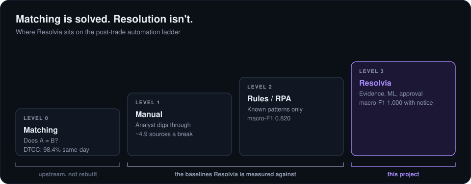

# 1. The problem

A reconciliation engine asks one question: does A equal B? When it doesn't, it raises a break. That part of post-trade operations is in good shape. DTCC reports 98.4% same-day matching for equities.

What happens next is still mostly people. Someone has to find the evidence, connect the records, work out why it broke, size the exposure, get sign-off, fix it and then prove it's actually fixed. SS&C GlobeOp reviews around 800,000 breaks a month. In Broadridge's survey of futures commission merchants, none said their break handling was fully automated.

I placed Resolvia at level 3, starting where matching ends. I chose not to rebuild matching. The two levels in between are the baselines I measure it against:

- **Manual (level 1).** I don't invent a stopwatch time. Instead I count how many evidence sources an analyst has to open to reach a root cause: the four tables every time, one more if there's a document, one more for a corporate action notice. That averages 4.9 per break.
- **Rules (level 2).** Hand-written if/else rules over the same 15 features the model sees. That's roughly what a rules engine or RPA bot can do without reading documents. It scores a macro-F1 of 0.820.

## The principle

> AI investigates. Humans authorise. Systems execute. AI validates.

Every design decision I made follows from that line. The agents can gather, diagnose and propose. Only a recorded human decision can let a consequential action run. And nothing counts as resolved until the records have been checked again.

## Scope

I scoped it to Indian cash equities (T+1, INR), four break families, 20 root causes, and corporate actions as the specialist case. I left derivatives, FX, securities lending, collateral and real payment systems out.

Next: [the data](02-the-data.md)
