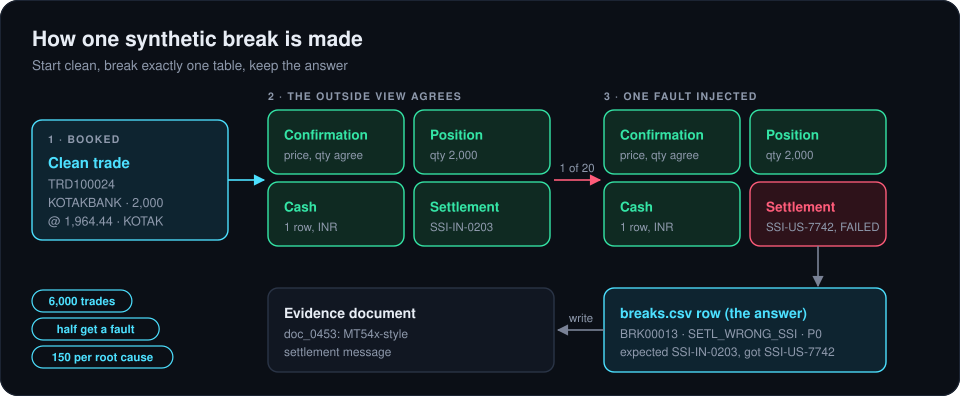
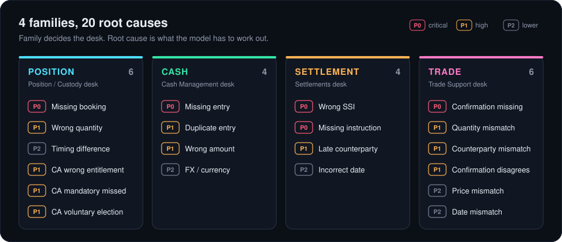

# 2. The data

There's no public dataset of real trade breaks. Trade and reconciliation data is confidential at every bank, custodian and broker. So I did what PaySim does for fraud: simulate clean operations, inject faults on purpose, and keep the answer for every one.

`data/generate_trade_breaks.py` builds 6,000 trades across 15 NSE stocks and six counterparties, settling T+1. For each trade it writes the outside world's view in four tables (the confirmation, the custodian position, the cash and the settlement), and they all agree. Then half the trades get exactly one fault, changing only the table that fault lives in. The result is 3,000 breaks, exactly 150 per root cause.

The 50% break rate is far higher than real life (1 to 5%). It's a training choice so that every class has enough examples, not a claim about how often breaks happen.

One detail matters a lot: trade breaks change the trade's own `confirmed_*` columns. If the discrepancy only lived on the breaks row, a model would just be reading the label.

## Twenty root causes

The family is what the reconciliation engine already tags and what Triage routes on. The root cause is what has to be worked out. Full definitions are in [`data/taxonomy.py`](../data/taxonomy.py) and every column is described in [`data/schema.md`](../data/schema.md).

## Documents

2,160 breaks come with a document, in the format a bank would actually receive:

| Family | Document | What's in it |
|---|---|---|
| Corporate action | SWIFT MT564-style notice | event type, ratio, and `:22F::CAMV//MAND` or `VOLU` |
| Settlement | SWIFT MT54x-style message | `:16R:` blocks, references, SSI and party codes |
| Trade | NSE/SEBI-style contract note | the counterparty's version of the trade, with charges |
| Position, cash | Ops correspondence | emails, terse notes, chat and WhatsApp messages, batch emails |

The informal ones are messy on purpose: "RIL" instead of RELIANCE, dates in three formats. Thirty documents are also rendered as scanned images for the OCR step.

`data/validate_dataset.py` checks referential integrity, split consistency and that every trade break is visible outside the breaks table.

Next: [the models](03-the-models.md)
