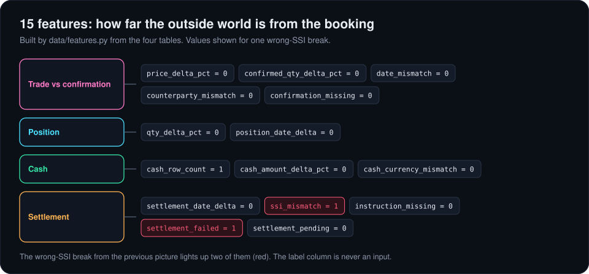
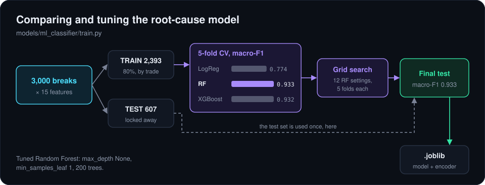
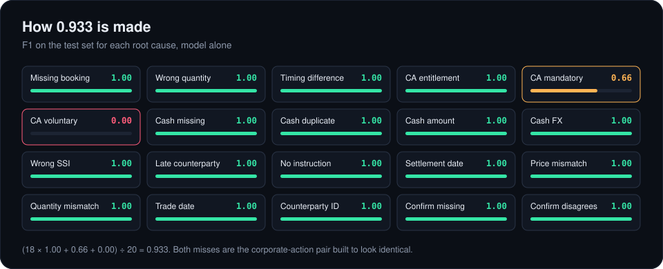
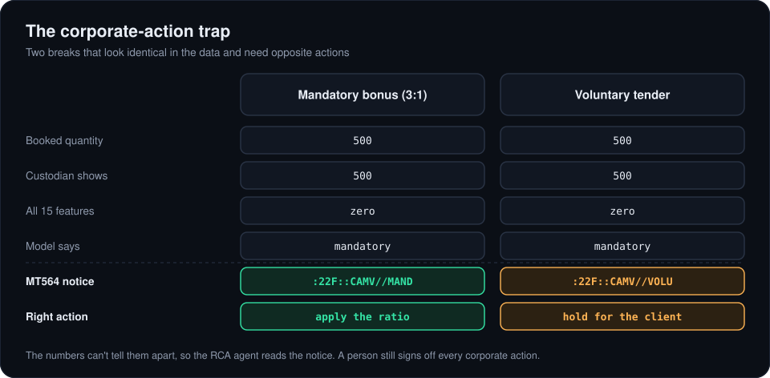

# 3. The models

There are two classifiers, both Random Forests on the same 15 features. The family model routes breaks in Triage. The root-cause model diagnoses them in RCA, and it's the one that gets compared and tuned.

## Features

[`data/features.py`](../data/features.py) joins each break's trade, position, cash and settlement rows and measures how far the outside world is from the booking: percentage differences, day differences, row counts and flags. The label columns are carried along as targets and never used as inputs.

## Choosing the target

The proposal said "classify the four break families". Before building anything I fitted three models on both targets ([`data/check_ml_targets.py`](../data/check_ml_targets.py)):

| Target | Logistic Regression | Random Forest | XGBoost |
|---|---|---|---|
| Family (4 classes) | 0.657 | 1.000 | 1.000 |
| Root cause (20 classes) | 0.744 | 0.944 | 0.944 |

Family is basically "which table has a difference", so tree models get it perfect and there's nothing to compare or tune. Root cause is a real problem with a real gap between models, so that became the target. Family is still reported by mapping each predicted cause to its family, and it comes out at 1.000. That easy family model is exactly what Triage wants for routing.

## Comparison and tuning

[`backend/models/ml_classifier/train.py`](../backend/models/ml_classifier/train.py) compares the three candidates with 5-fold stratified cross-validation on the training set, scored on macro-F1 so every class counts the same. Random Forest and XGBoost tie at about 0.93; Random Forest wins by a hair and is simpler, so it gets tuned with a grid search and evaluated once on the test set. The test set isn't touched until then.

## How 0.933 is made

Eighteen of the twenty classes are perfect. The two that aren't are the trap built into the data on purpose.

A mandatory corporate action that hasn't been applied and a voluntary one waiting for the client's choice look identical in the numbers: in both, the custodian still shows the pre-event quantity. The model predicts "mandatory" every time, so voluntary scores 0.00. The difference is written on the notice, in its CAMV field.

That's the argument for the rest of the system. A structured model alone hits a ceiling exactly where a business judgment lives. So the RCA agent reads the notice and corrects the model, and every corporate action goes to a person no matter how confident anyone is. In the running system that takes root-cause macro-F1 on the test set from 0.933 to 1.000.

The near-perfect scores elsewhere come from clean synthetic data. They show the features work; they don't show real breaks are this easy. The full report is in [`analysis/model_comparison.md`](analysis/model_comparison.md).

Next: [the agents](04-the-agents.md)
