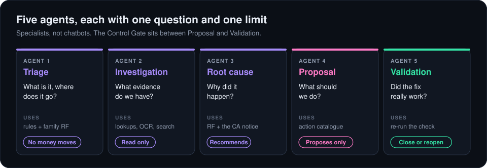
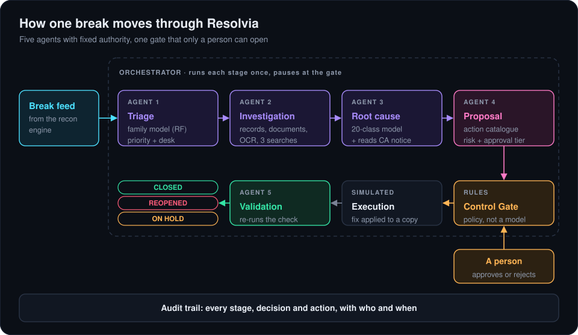
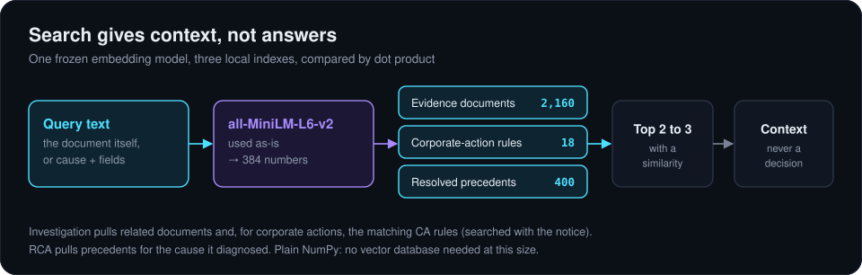

# 4. The agents

I built each agent as a Python module in [`backend/agents/`](../backend/agents) with one entry function, a fixed input and output, and a stated limit on what it's allowed to do. They're specialists rather than chatbots: each one uses the cheapest tool that does its job reliably, and the LLM is optional throughout.

## Triage

`triage.py` answers "what is this and where does it go?"

1. Plain data checks: the trade, position and settlement records exist and the break is OPEN. If not, the case stops as `HALTED_DATA_QUALITY`.
2. The family model predicts POSITION, CASH, SETTLEMENT or TRADE.
3. The prediction is compared with the family the reconciliation engine tagged. A disagreement is shown, not quietly resolved.
4. Priority is URGENT for P0 or exposure of ₹10 lakh and up, HIGH for P1, STANDARD otherwise. The break goes to the desk for its family, and every corporate action goes to the CA specialists.

## Investigation

`investigation.py` answers "what evidence do we have?" It reads and retrieves; it never judges. It returns the trade, position, cash and settlement records, the document (OCR if it only exists as a scan), the three most similar other documents and, for corporate actions, the matching entries from an 18-entry reference base, searched with the notice itself.

It only sees what the reconciliation engine would hand over. The root-cause columns in `breaks.csv` are ground truth for training, and I keep them out of the running system on purpose.

## Root cause

`rca.py` answers "why did it happen?" and writes a decision record: expected, actual, field, root cause, confidence, alternatives, evidence cited, and whether a person needs to review it.

- The root-cause model gives the diagnosis and its alternatives from `predict_proba`.
- For corporate actions it reads the MT564 notice: the CAMV field, the event code and the narrative, each tolerant of one OCR slip. If they agree and the model disagrees, the notice wins and the record says so. If they conflict, the notice isn't trusted and the break falls back to the model and a person.
- Two fixed rules decide whether a person must review the diagnosis: any corporate action, or calibrated confidence below 0.80, a threshold I chose by cost ([stress tests](09-robustness.md)). Confidence never decides authority.
- It looks up precedents for the cause it diagnosed: what happened on similar cases before.
- An optional LLM step turns the record into a short paragraph for the analyst. It's told not to recommend anything.

## Resolution proposal

`resolution.py` answers "what should we do?" Once the cause is known the fix is mechanical, so I put the fixes in a fixed catalogue rather than having them made up each time. Each entry has an action, an expected outcome and an authority tier:

- **CONTROLLED_ACTION** for 15 causes: anything that changes money, a quantity, an SSI or a counterparty.
- **PROPOSAL** for 5 administrative ones: wait for a timing difference, chase a late counterparty or a missing confirmation, fix a date.

Risk is arithmetic: HIGH for P0 or ₹10 lakh and up. A voluntary corporate action gets a **hold**: nothing changes until the client's election arrives.

I keep two flags apart in the proposal. RCA's flag is about the diagnosis; the approval flag is about the action. A confident diagnosis can still lead to an action that needs sign-off.

## Validation

`validation.py` answers "did the fix actually work?" It re-runs the comparison that raised the break: the break feed says which field disagreed and what it should have been, and Validation reads that field from the updated records. It doesn't care what the diagnosis was, so a wrong diagnosis that led to the wrong fix gets caught and the case reopens.

Next: [control and audit](05-control-and-audit.md)
