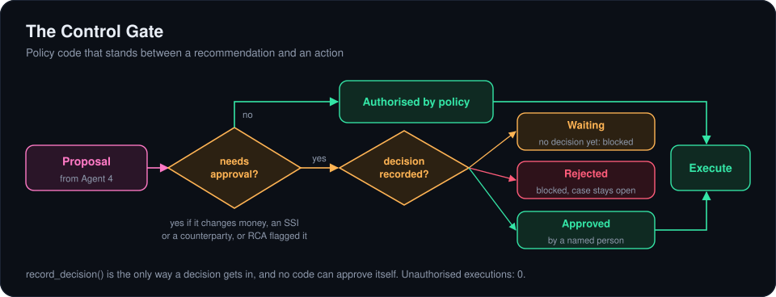
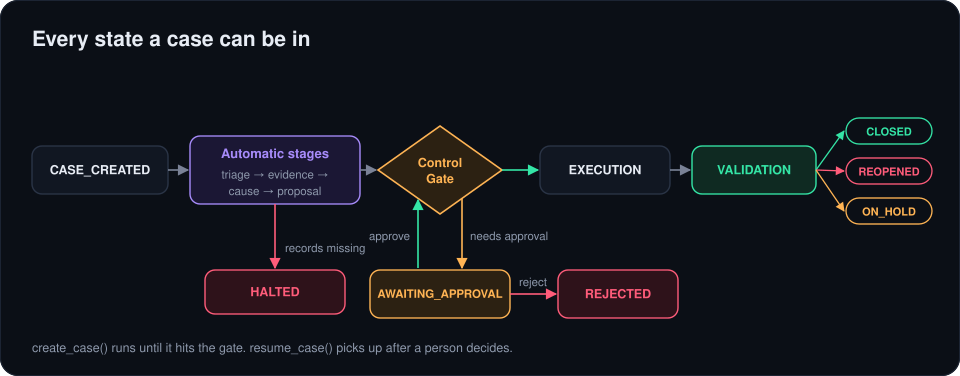
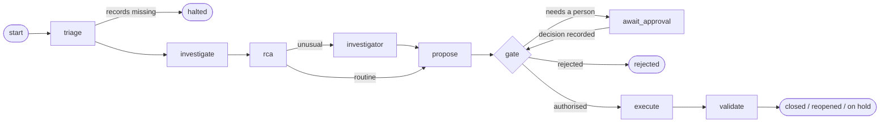
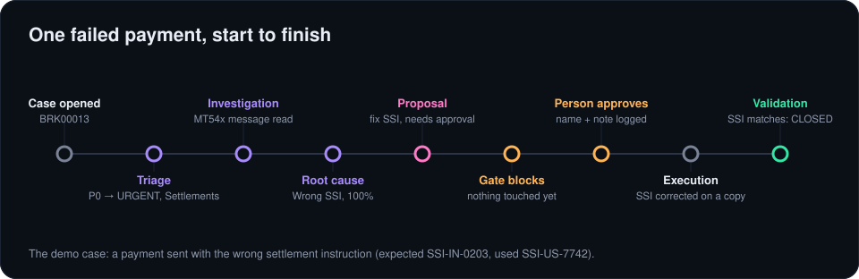
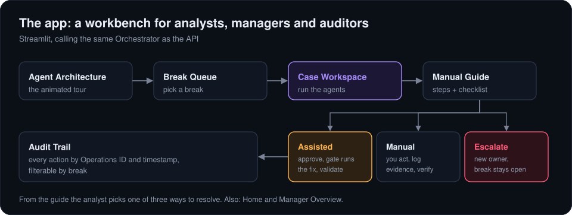

# 5. Control and audit

## The Control Gate

I wrote [`backend/control_gate.py`](../backend/control_gate.py) as policy code, not a model. A proposal goes through on policy only if it's an administrative PROPOSAL-tier step on a diagnosis nobody flagged. Everything else needs an APPROVE recorded against that break. No decision, or a REJECT, means blocked, and nothing is touched.

`record_decision()` is the only way a person's decision gets in. Nothing in the backend can approve on its own behalf. Across every run in this repo the number of unauthorised executions is zero.

## The Orchestrator and case states

[`backend/orchestrator.py`](../backend/orchestrator.py) is a [LangGraph](https://github.com/langchain-ai/langgraph) `StateGraph`. The case is the graph's state, each agent is a node, and conditional edges decide where the case goes next:

- **Routing.** A routine case runs straight down the line. A case with unusual signals goes to the Investigator after RCA, and a case with missing records ends at Triage.
- **Waiting for a person.** `await_approval` is a LangGraph interrupt. `create_case()` runs the graph until the gate blocks, and the graph pauses there with the case as AWAITING_APPROVAL. Once someone records a decision, `resume_case()` resumes the graph at the gate, which checks again: an approval runs the fix, a rejection ends the case.
- **Checkpoints.** A checkpointer keeps each paused run, and every run is saved to SQLite. After a restart, the graph's entry router reads the saved case and sends it straight to the stage it had reached.
- **One decision.** The Orchestrator only routes. Whether an action needs approval is the gate's call, and there is no edge to `execute` that doesn't come from the gate.

`orchestrator.mermaid()` prints the compiled graph.

The outcomes after execution:

- **CLOSED**: the field that broke now matches.
- **REOPENED**: it still doesn't. That needs another look, not a blind retry.
- **ON_HOLD**: a voluntary corporate action, left alone on purpose until the client chooses.
- **OPEN**: the gate blocked it, so nothing ran. That's the gate working, not a failed fix.

## Execution

[`backend/execution_simulator.py`](../backend/execution_simulator.py) applies the approved fix to a copy of the records, never the source data. It applies the fix the proposal asked for, so if the diagnosis was wrong, the wrong fix runs and Validation catches it. Where the real fix depends on someone outside the bank (a counterparty settling, a confirmation arriving) the simulation stands for that event having happened.

## The audit trail

I kept three layers, so the auditor's question ("who approved what, when, and based on what?") always has an answer:

1. Each case keeps its own history of every stage, with UTC timestamps.
2. The gate keeps its own log of every check and every decision.
3. The app writes every human and system action to an operational log (`backend/audit.py`) with the operator's ID.

## One case, start to finish

This is the case I use to demo it. Break BRK00013 is a P0 payment sent with the wrong settlement instruction. Triage marks it urgent and sends it to Settlements. Investigation reads the MT54x message. RCA diagnoses the wrong SSI with full confidence. The proposal is to correct the SSI and resubmit, which is a controlled action, so the gate blocks it. A person approves with a note. The fix runs on a copy, Validation sees the SSI now matches, and the case closes.

## The app

The Streamlit app in [`frontend/`](../frontend) calls the same Orchestrator. Before a break is diagnosed the queue shows what the reconciliation engine reported ("Settlement instruction differs"); after RCA it shows the diagnosis. There's also a small REST API in [`backend/api/main.py`](../backend/api/main.py) for opening cases and recording decisions from another system.

Next: [results](06-results.md)
