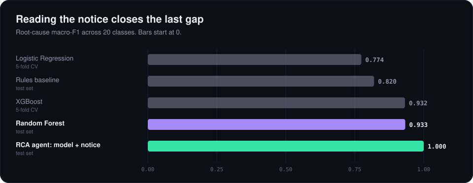
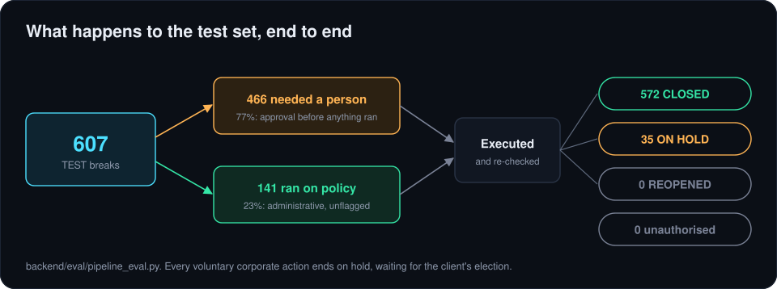

# 6. Results

| | Root-cause macro-F1 | Source |
|---|---:|---|
| Logistic Regression (5-fold CV) | 0.774 | `backend/models/ml_classifier/train.py` |
| Rules baseline (test) | 0.820 | `backend/eval/baseline_comparison.py` |
| XGBoost (5-fold CV) | 0.932 | `train.py` |
| Random Forest, tuned (test) | 0.933 | `train.py` |
| RCA agent: model plus the notice (test) | 1.000 | `backend/eval/pipeline_eval.py` |

The rules baseline gets every mechanical cause and none of the corporate-action ones. The model gets all but the mandatory and voluntary pair. Reading the notice gets the rest.

## The whole system on the test set

`pipeline_eval.py` runs every test break through the Orchestrator, approves anything waiting on a person, and counts the outcomes.

| Measure | Result |
|---|---:|
| Test breaks | 607 |
| Needed a person before anything ran | 466 (77%) |
| Ran straight through on policy | 141 (23%) |
| Closed after re-checking the records | 572 |
| On hold for a client election | 35 |
| Reopened | 0 |
| Unauthorised executions | 0 |

## Other numbers

| | |
|---|---:|
| Family, Triage model and derived from root cause | 1.000 |
| OCR key-token accuracy on the 30 scans (`backend/ocr/verify_ocr.py`) | about 99% |
| Manual baseline: evidence sources an analyst opens per break | 4.89 |
| Precedent cases (`backend/knowledge/resolved_cases.json`) | 400: 380 closed, 20 on hold |
| Root causes run end to end through the Orchestrator | 20 of 20 |

## How to read them

The data is synthetic and clean, so the near-perfect scores show that the features and the pipeline work, not that real breaks are this easy. The finding that carries over is the shape of it: rules and a structured model both stall on the case that needs a document and a judgment, and that's the case the system is built around.

Next: [limits and next steps](07-limits-and-next-steps.md)
