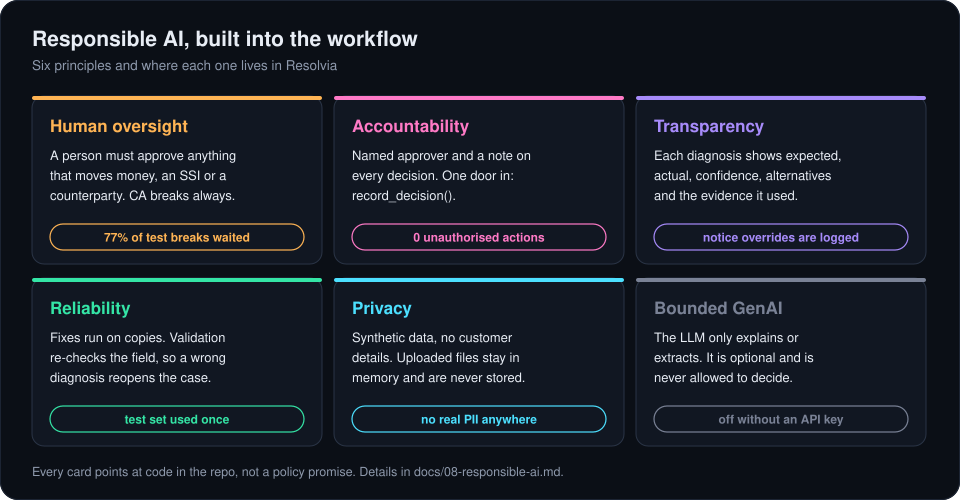

# 8. Responsible AI and governance

In operations, a wrong automated action is a failed payment or a wrong position. So I treated governance as part of the design from the start, not something to add at the end. Every principle below maps to code in this repo.

## How each principle shows up

| Principle | What I built | Where it lives | Evidence |
|---|---|---|---|
| **Human oversight** | Anything that changes money, a quantity, an SSI or a counterparty waits for a person. So does any diagnosis RCA flags: every corporate action, and anything below 70% confidence. | `backend/control_gate.py`, `backend/agents/rca.py` | 466 of 607 test breaks (77%) waited for a person |
| **Accountability** | `record_decision()` is the only way an approval gets in, and it records who, when and why. Each case also keeps its own history, the gate keeps a log, and the app logs every action with the operator's ID. | `backend/control_gate.py`, `backend/orchestrator.py`, `backend/audit.py` | 0 unauthorised executions in every run |
| **Transparency** | RCA writes a decision record: expected vs actual, the field, confidence, alternatives the model considered, and every piece of evidence it used. When the notice overrides the model, the record says so. | `backend/agents/rca.py` | the override is logged in the case history |
| **Reliability** | Fixes run on copies, never the source. Validation re-runs the original comparison instead of trusting the diagnosis, so a wrong fix reopens the case. The test set was used once. | `backend/execution_simulator.py`, `backend/agents/validation.py` | 0 reopened and 0 wrong diagnoses on the test set |
| **Privacy** | All data is synthetic, with made-up BICs, SEBI numbers and client codes. Documents uploaded in the app are read in memory for that session and never written to disk. | `data/`, `frontend/document_evidence.py` | no real customer data anywhere |
| **Bounded GenAI** | The LLM can extract fields and write a short explanation. Its prompt forbids recommending actions, its output is labelled unverified, and the system runs fully without it. | `backend/llm.py`, `backend/agents/ingestion.py` | every decision works with no API key |

## Rules I chose not to learn

Some decisions are governance choices, so I wrote them as fixed rules rather than letting a model learn them:

- **Confidence never decides authority.** A 100%-confident model still needs approval for a controlled action. The model is confidently wrong on voluntary corporate actions, which is exactly why.
- **Corporate actions always go to a person**, even after the notice has been read, because in real life a notice can be late, missing or a bad scan.
- **Voluntary events are held**, not fixed, until the client's election arrives.
- **The running system never sees the answer.** The root-cause label in the data is used for training and evaluation only.

## Mapping to the NIST AI Risk Management Framework

| Function | What it asks | How Resolvia answers it |
|---|---|---|
| Govern | Who is accountable, and what are the rules? | Authority tiers per action, one approval door, named approvers |
| Map | What's the context and what could go wrong? | Scoped to cash equities; each agent's authority written down; the corporate-action failure mode found and designed for |
| Measure | How do you know it works? | Rules baseline, cross-validation, one-time test set, per-class F1, end-to-end evaluation |
| Manage | What happens when it's wrong? | Human approval before action, re-check after action, REOPENED instead of a silent retry, full audit trail |

## What I haven't covered yet

- **Fairness.** This system doesn't make decisions about people, so fairness in the usual sense doesn't apply directly. The closest question is whether some counterparties or clients get slower or worse handling. I haven't measured that.
- **Drift.** The model was trained on one fault per trade. In production I'd monitor confidence and override rates and retrain when they move.
- **Real access control.** Approval rights should come from the bank's directory, with a rule that nobody approves their own work. Here the operator ID is typed in.

The model itself is documented in the [model card](model-card.md).

Back to [the tour](README.md)
