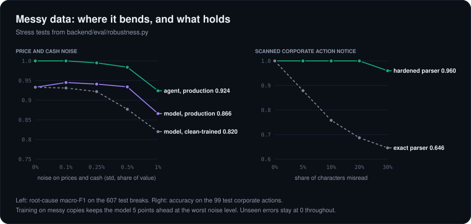
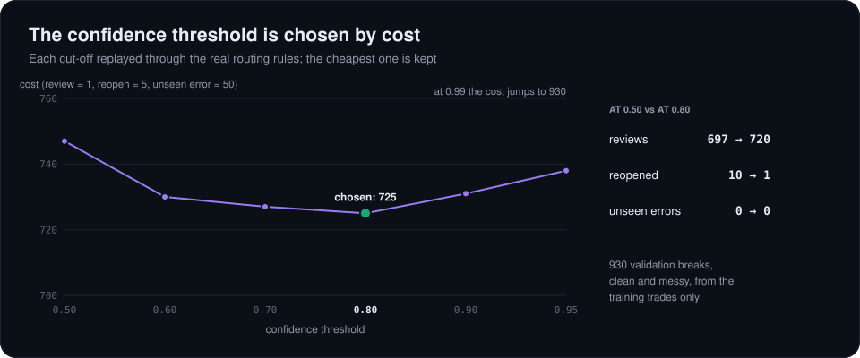
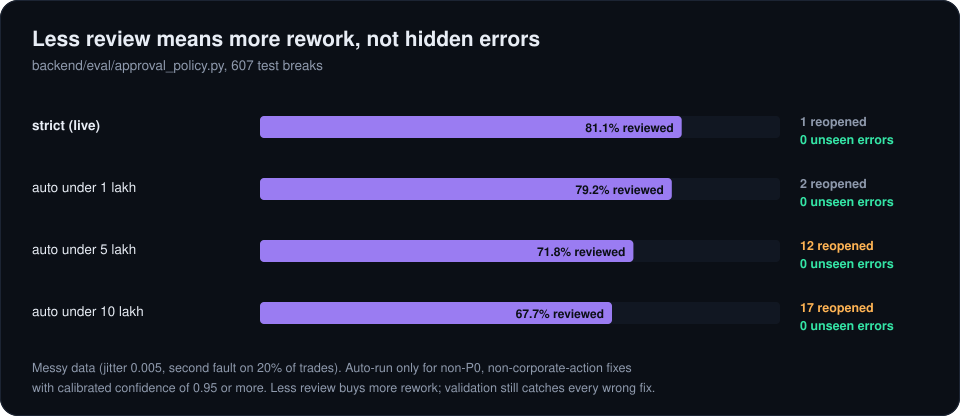
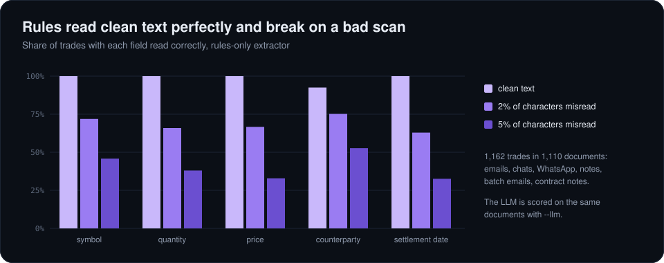

# 9. Stress tests and modelling depth

A perfect score on clean synthetic data proves the plumbing works and not much else. So I made the data messy on purpose, measured where things bend, and changed the model so it bends less. Every number here comes from scripts in `backend/eval/` and is scored on the 607 held-out test breaks.

## Making the data messy

[`data/perturb.py`](../data/perturb.py) adds two kinds of mess to the records before features are built:

- **Jitter.** Random noise on confirmed prices and posted cash amounts, like rounding, fees or a slightly stale rate. At 1% it starts to overlap with genuine price mismatches.
- **A second fault.** Some trades get another, unrelated fault from a different break family, injected with the generator's own functions. The break feed still reports the first one, and naming either counts as right.

For the corporate action notices it can also misread characters the way a bad scan does, or drop the notice entirely.

## Results



| Scenario | Model alone, clean-trained | Model alone, production | RCA agent, production |
|---|---:|---:|---:|
| Clean data | 0.933 | 0.933 | 1.000 |
| 0.5% price and cash noise | 0.877 | 0.934 | 0.984 |
| 1% price and cash noise | 0.820 | 0.866 | 0.924 |
| Everything at once* | 0.904 | 0.937 | 0.973 |

\*0.5% noise, a second fault on 20% of trades, notices scanned with 5% of characters misread, and a quarter of notices missing. Full tables, including a second fault on up to 40% of trades and label noise, are in [`analysis/robustness.md`](analysis/robustness.md).

What I take from it:

- **Accuracy bends, safety doesn't.** In every scenario the number of wrong fixes that would run without anyone noticing stays at zero. Wrong diagnoses either reach a person first or fail Validation's re-check and reopen.
- **Training on messy copies helps.** The production model keeps 4 to 5 points over the clean-trained one at the highest noise level, and costs nothing on clean data.
- **A harder-working parser matters more than a better model** for corporate actions. Reading only the CAMV field falls to 65% accuracy when 30% of characters are misread. Cross-checking the event code and the narrative, with tolerance for one OCR slip each, keeps it at 96%.
- **A missing notice is the real weak spot.** With no notice, accuracy on corporate actions drops to 65%, which is exactly why every corporate action still goes to a person.
- **Label noise barely registers.** Flipping 20% of the training labels costs about 1.4 points.

## Three changes to the model

[`backend/models/ml_classifier/build_production.py`](../backend/models/ml_classifier/build_production.py) builds the model the RCA agent actually runs:

1. **Noise-augmented training.** Besides the clean training breaks, the model sees three perturbed copies of them. Labels stay the cause the break feed reported.
2. **Calibration.** A random forest's vote shares aren't probabilities. On clean data 86% of its confidences were exactly 0 or 1, which makes any threshold meaningless. Isotonic calibration, with folds that keep every copy of a break together, fixes that. On messy data the calibration error drops from 0.097 to 0.024.
3. **A threshold chosen by cost.** I replayed every candidate threshold through the real routing rules on a validation slice of the training trades, pricing a review at 1, a reopened fix at 5 and an unseen error at 50, and kept the cheapest.



The cost curve is flat between 0.6 and 0.9 and turns up sharply past 0.95. I chose 0.80: 23 more reviews than 0.50 in exchange for 9 fewer reopened fixes.

## How much human review is enough?

Today every controlled action waits for a person, which on messy data is about 81% of breaks. [`eval/approval_policy.py`](../backend/eval/approval_policy.py) tests rules that let small, confident, non-critical fixes run straight away.



Cutting review to 68% of breaks costs 16 more reopened fixes and no unseen errors, because Validation still re-checks every fix. I left the live gate strict: the saving is real, but a bank should choose that limit, not the model. The same script shows what happens when reviewers miss mistakes. Missing a fifth of them on the messiest data, about 7 of 35 wrong diagnoses get past the reviewer; Validation catches most of those, and the one or so that close are cases where the wrong label's fix also puts the right value back.

## Measuring the Gen AI layer

The LLM's job is reading free-text documents, so I built [`eval/extraction_eval.py`](../backend/eval/extraction_eval.py) to score it field by field against the ground truth in `broker_confirms_mapping.csv`: 1,162 trades in emails, chats, WhatsApp messages, notes, batch emails and contract notes.



As a baseline I wrote a rules-only extractor. Because I wrote it knowing the templates, it reads clean text almost perfectly (chat messages never name the counterparty, so no extractor can get that field). Once 5% of characters are misread, it falls to about a third on prices, quantities and dates. That's the gap the LLM is there to close, and the same script scores it on the same documents:

```bash
cd backend
python eval/extraction_eval.py --llm --noise 0.05 --limit 150
```

## Engineering

- **Tests.** 23 tests in [`tests/`](../tests) cover the gate rules, the notice parser, Validation, the end-to-end pipeline, persistence and the rules extractor. They run on every push through GitHub Actions.
- **Saved state.** Cases, approval decisions, the gate's log and the audit trail now live in SQLite ([`backend/store.py`](../backend/store.py)), so an open case and its history survive a restart.

Back to [the tour](README.md)
